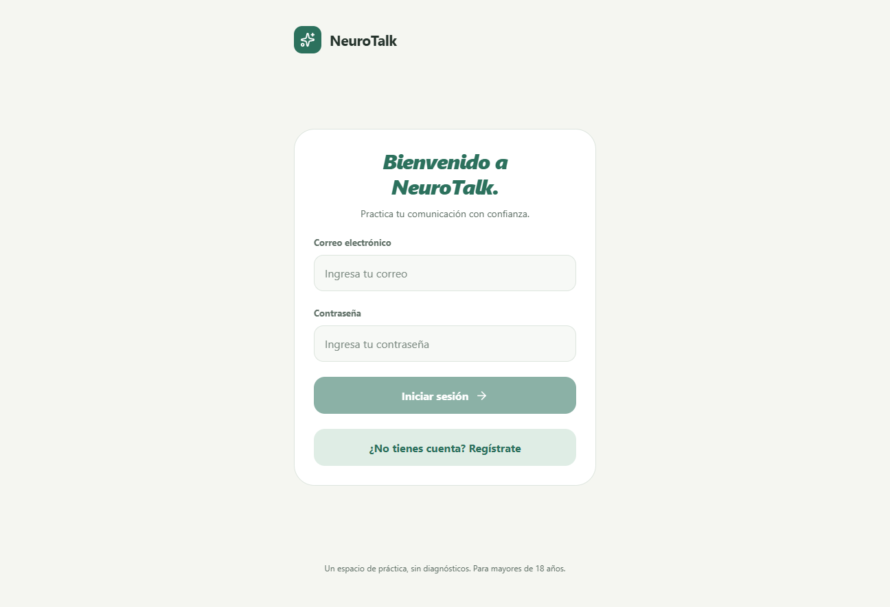
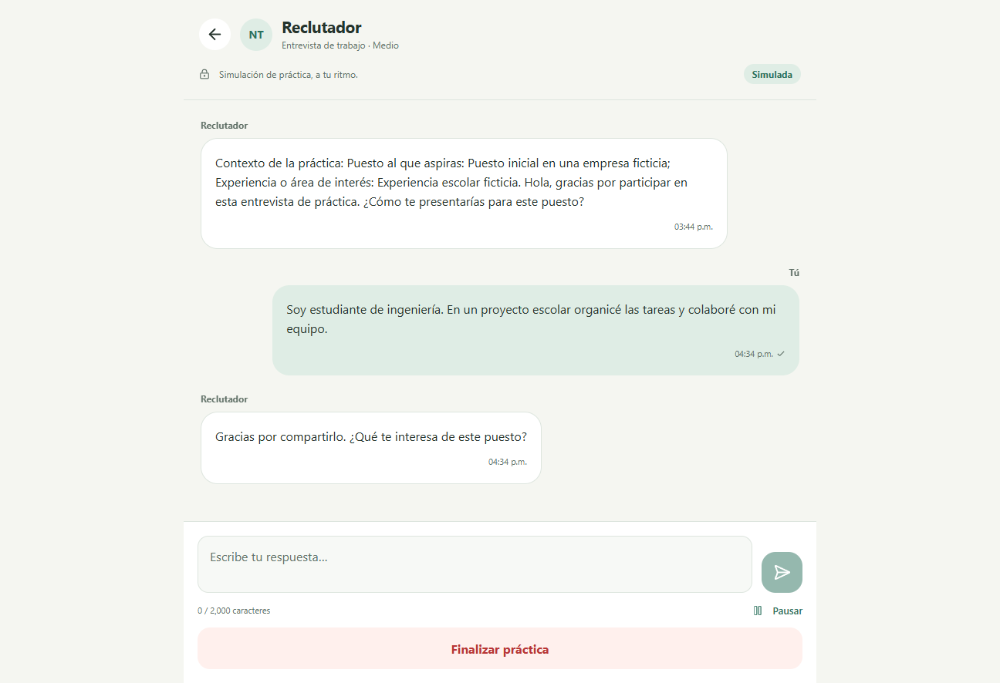
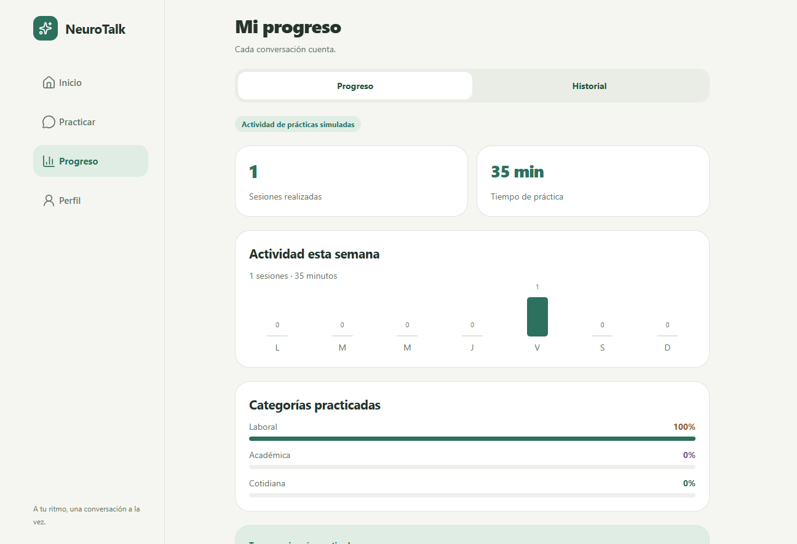

# NeuroTalk — Manual de usuario y guía de pruebas

**Versión:** prototipo escolar con conversaciones simuladas.  
**Dirigido a:** Ángel, profesor y personas que revisen el prototipo local.  
**Entrega actual:** Avance 2 web, probado en navegador de escritorio y ventana estrecha. Móvil queda pendiente por decisión del responsable; no se debe iniciar Android Studio/emulador para esta entrega.

> Usa exclusivamente datos ficticios y una cuenta de prueba. Esta versión no utiliza OpenAI, no genera diagnósticos y todavía no produce retroalimentación personalizada.

## Índice

1. [Abrir la aplicación](#1-abrir-la-aplicación)
2. [Crear una cuenta e iniciar sesión](#2-crear-una-cuenta-e-iniciar-sesión)
3. [Conocer Inicio y la navegación](#3-conocer-inicio-y-la-navegación)
4. [Buscar y configurar un escenario](#4-buscar-y-configurar-un-escenario)
5. [Conversar con el personaje](#5-conversar-con-el-personaje)
6. [Pausar y continuar](#6-pausar-y-continuar)
7. [Finalizar y consultar el resultado](#7-finalizar-y-consultar-el-resultado)
8. [Historial y progreso](#8-historial-y-progreso)
9. [Perfil y cierre de sesión](#9-perfil-y-cierre-de-sesión)
10. [Borrar prácticas y cuenta](#10-borrar-prácticas-y-cuenta)
11. [Pruebas adicionales de límites y recuperación](#11-pruebas-adicionales-de-límites-y-recuperación)
12. [Lista de comprobación](#12-lista-de-comprobación)
13. [Problemas frecuentes](#13-problemas-frecuentes)
14. [Qué no debes esperar todavía](#14-qué-no-debes-esperar-todavía)
15. [Anexo: iniciar el proyecto local](#15-anexo-iniciar-el-proyecto-local)

---

## 1. Abrir la aplicación

### Si la vista de revisión sigue ejecutándose

Abre **http://localhost:8084** en el mismo equipo donde está el proyecto. Esta vista se preparó con el backend en el puerto 3014 y la **base de pruebas**, no la de desarrollo.

Si ya no abre, no significa que se hayan borrado datos: los servidores locales pueden estar detenidos. Utiliza el [anexo de inicio](#15-anexo-iniciar-el-proyecto-local) o pide al responsable que los inicie.

### Si inicias el proyecto de manera habitual

La dirección prevista es **http://localhost:8081**, con el backend en el puerto 3000. El terminal de Expo indica la dirección efectiva.

**No mezcles ambas configuraciones.** Las cuentas de la base de pruebas y las de desarrollo son independientes; una cuenta creada en una puede no existir en la otra. Tampoco intercambies `localhost` y `127.0.0.1` durante la prueba.

**Resultado esperado:** aparece el acceso de NeuroTalk o Inicio si ya hay una sesión válida.



*Referencia visual del prototipo; el tamaño cambia según la ventana.*

## 2. Crear una cuenta e iniciar sesión

### 2.1 Registro

1. Pulsa **¿No tienes cuenta? Regístrate**.
2. Completa los campos con datos ficticios. Por ejemplo:

   | Campo | Dato de ejemplo |
   | --- | --- |
   | Nombre para mostrar | Usuario de prueba |
   | Correo electrónico | manual.usuario@example.test |
   | Contraseña exclusiva para esta prueba | PruebaLocal-2026! |

   Los ejemplos son públicos: **no uses esa contraseña para una cuenta real ni fuera de la demostración local**. Si el correo de ejemplo ya existe, usa uno distinto.

3. Pulsa **Crear cuenta**.
4. Espera el aviso de que la cuenta fue creada.

**Reglas actuales:** nombre, correo y contraseña obligatorios; contraseña de al menos 12 caracteres y máximo 72 bytes UTF-8. Letras acentuadas y emojis pueden ocupar varios bytes. El correo debe tener formato válido y no estar registrado.

**Resultado esperado:** vuelves al formulario de acceso. El registro **no inicia sesión automáticamente**. No recibirás un correo de confirmación en esta entrega.

### 2.2 Acceso

1. Escribe el correo y la contraseña de la cuenta que acabas de crear.
2. Pulsa **Iniciar sesión**.

**Resultado esperado:** aparece Inicio con un saludo basado en el nombre de tu cuenta. Si una contraseña es incorrecta, debe aparecer un error sin permitir el acceso.

## 3. Conocer Inicio y la navegación

Inicio muestra:

- Saludo y fecha.
- Botón **Comenzar práctica**.
- Accesos a escenarios.
- **Continúa a tu ritmo**, con las prácticas pendientes y el contador de cupos.
- Prácticas recientes, cuando ya hayas finalizado alguna.

La navegación tiene cuatro secciones:

| Sección | Para qué sirve |
| --- | --- |
| Inicio | Comenzar o retomar prácticas |
| Practicar | Explorar el catálogo |
| Progreso | Consultar actividad e historial |
| Perfil | Cambiar el nombre, cerrar sesión o eliminar cuenta |

En una ventana amplia, la barra está a la izquierda; en anchos pequeños, abajo. Dentro del chat se oculta para que salgas mediante el control que pausa la conversación.

**Navegación web:** las pantallas ya tienen direcciones con `#`, por ejemplo `#/inicio`, `#/practicar` o `#/practicas/<id>`. Puedes usar los botones internos o Atrás/Adelante del navegador. Al salir del chat con los botones internos se espera la pausa; con Atrás/Adelante se intenta notificarla en segundo plano y permanece el respaldo de 15 minutos de inactividad. No incluyas tokens, contraseñas o contexto personal en direcciones compartidas.

## 4. Buscar y configurar un escenario

### 4.1 Explorar la biblioteca

1. Pulsa **Comenzar práctica** o entra en **Practicar**.
2. Elige **Cotidiana**, **Académica** o **Laboral**.
3. Abre una tarjeta de escenario.

También puedes escribir `entrevista` en **Buscar escenarios** para encontrar **Entrevista de trabajo**. Para reiniciar el filtro, pulsa **Ver todas las categorías**.

El catálogo inicial contiene:

| Laboral | Académica | Cotidiana |
| --- | --- | --- |
| Entrevista de trabajo | Solicitar ayuda a un profesor | Iniciar una conversación |
| Atención a cliente molesto | Defender una idea o proyecto | Resolver un malentendido |
| Hablar con un supervisor | Resolver un problema en equipo | Expresar una opinión diferente |

**Resultado esperado:** el detalle muestra el personaje, objetivo y duración estimada del escenario. Los 10–15 minutos indicados son una referencia, **no un límite que cierre automáticamente la práctica**.

### 4.2 Elegir dificultad

1. Pulsa **Configurar práctica**.
2. Selecciona una dificultad:
   - **Fácil:** preguntas directas y mayor orientación.
   - **Medio:** conversación natural y preguntas de seguimiento.
   - **Difícil:** preguntas más exigentes, siempre respetuosas.
3. Si lo deseas, pulsa **Personalizar contexto (opcional)**.
4. En Entrevista de trabajo, puedes escribir:
   - Puesto: `Desarrollador de software principiante`.
   - Experiencia: `Proyectos escolares de programación`.
5. Pulsa **Iniciar práctica**.

Si dejas los campos opcionales vacíos, se utiliza un contexto ficticio. No necesitas subir un CV ni compartir datos reales.

**Resultado esperado:** se abre una nueva práctica y se conserva su dificultad/contexto. No hay un control para cambiarlos dentro de la conversación; para otra configuración inicia una práctica nueva.

## 5. Conversar con el personaje

1. Comprueba el escenario y dificultad del encabezado.
2. Confirma que se identifica como práctica **Simulada**.
3. Escribe en **Escribe tu respuesta…**.
4. Pulsa el botón de envío con forma de flecha.
5. Espera la respuesta antes de enviar el siguiente mensaje.

Ejemplos ficticios para una entrevista:

> Soy estudiante de ingeniería y me interesa desarrollar software. En un proyecto escolar organicé tareas con mi equipo.

> Me interesa este puesto porque quiero aplicar mis conocimientos y aprender de otros desarrolladores.

> Mi aportación fue crear una parte de la aplicación y documentar cómo probarla.

**Resultado esperado:** tus mensajes aparecen diferenciados de los del personaje y se conservan al volver a la práctica. Los mensajes enviados no se pueden editar.



### Quién inicia

Depende del escenario. En Entrevista de trabajo comienza el reclutador. En Solicitar ayuda a un profesor, escribe tú primero; una indicación inicial sin mensajes del personaje no significa que el sistema haya fallado.

### Límites y comportamiento

- Máximo **2,000 caracteres Unicode por mensaje**; el campo limita la entrada y muestra un contador. Pegar un texto más largo puede recortarlo al límite.
- No se aceptan mensajes vacíos o con solo espacios.
- Máximo **30 mensajes tuyos** por práctica, no 30 mensajes totales.
- Desde el mensaje 25 aparece el aviso de cierre próximo.
- Si hay un envío/respuesta en proceso, algunos controles se deshabilitan temporalmente.

**El personaje todavía usa guiones.** Puede repetir preguntas, recorrer otros enfoques o no comprender por completo tu respuesta. No es una conversación generada por ChatGPT y no debes evaluar esta entrega como si ya lo fuera.

## 6. Pausar y continuar

### Pausa dentro del chat

1. Pulsa **Pausar**.
2. Comprueba el aviso de práctica pausada.
3. Pulsa **Reanudar práctica** para continuar.

### Salir y regresar

1. Usa la flecha de regreso del encabezado del chat.
2. Regresa a Inicio.
3. Localiza la conversación en **Continúa a tu ritmo**.
4. Pulsa su tarjeta para retomarla.

**Resultado esperado:** aparecen los mensajes anteriores, con la misma configuración. Las pausas registradas no suman tiempo de práctica.

### Inactividad

Después de **15 minutos sin actividad conversacional**, la práctica se pausa. Consultar o refrescar el chat no cuenta como enviar un mensaje.

Cambiar de pestaña o enviar la aplicación a segundo plano intenta pausar antes. Por eso, para probar específicamente el umbral de 15 minutos, mantén el chat visible sin enviar mensajes y espera el aviso; cambiar de pestaña no es una prueba equivalente.

Cerrar inesperadamente el navegador no garantiza que el servidor reciba la pausa en ese instante. No interpretes esa situación como pérdida de datos: comprueba Inicio al volver.

## 7. Finalizar y consultar el resultado

1. Envía al menos un mensaje para que la práctica pueda alimentar los indicadores.
2. Pulsa **Finalizar práctica**.
3. Espera el cierre si todavía hay una respuesta en proceso.
4. Pulsa **Ver resultado de la práctica**.

**Resultado esperado:** ves escenario, dificultad, duración y mensajes guardados. La duración excluye las pausas registradas, pero puede incluir espera entre mensajes hasta el umbral de inactividad; **no mide tiempo de concentración ni habilidad comunicativa**.

El resultado informa que la retroalimentación con IA estará disponible después. El recordatorio general para seguir practicando **no es un análisis personalizado**.

Opciones disponibles:

- **Volver a practicar:** vuelve a configurar el escenario; comenzar crea otra práctica.
- **Ver conversación guardada:** abre los mensajes en modo de consulta, sin permitir escribir en una práctica finalizada.
- **Ir al inicio:** regresa a Inicio.

Una práctica finalizada no se reabre para agregar mensajes. Puedes consultar sus mensajes o iniciar otra.

## 8. Historial y progreso

### Historial

1. Entra en **Progreso** desde la navegación.
2. Pulsa **Historial** en el selector de esa pantalla.
3. Abre la tarjeta de una práctica finalizada para consultar su resultado.

**Resultado esperado:** las prácticas aparecen agrupadas por mes. Las pendientes se retoman desde Inicio, no desde este historial de finalizadas.

### Indicadores

Pulsa **Progreso** en el selector interno. Puedes consultar:

- Sesiones realizadas.
- Tiempo acumulado de práctica.
- Actividad semanal de lunes a domingo.
- Distribución por categorías.
- Escenario más practicado o uno de los empatados.



*Los números de esta captura pertenecen a una prueba anterior; no son cifras que deban aparecer en tu cuenta.*

**Qué cuenta:** prácticas simuladas finalizadas con al menos un mensaje tuyo. Las conversaciones sin participación pueden aparecer en Historial, pero no suman como sesión realizada. Las pausadas tampoco suman todavía.

**Qué no significa:** no es una calificación, un diagnóstico ni un porcentaje de mejora comunicativa. Los porcentajes de categorías describen uso y pueden tener redondeos. Se utiliza la zona horaria del perfil, indicada en la pantalla.

Si acabas de borrar una práctica, sus datos deben dejar de aparecer en los indicadores al recargar la información. Una cuenta nueva debe mostrar ceros y estados vacíos.

## 9. Perfil y cierre de sesión

### Cambiar el nombre

1. Entra en **Perfil**.
2. Edita **Nombre para mostrar**.
3. Pulsa **Guardar cambios**.
4. Regresa a Inicio y comprueba el saludo.

**Resultado esperado:** se guarda el nombre de tu propia cuenta. Cambiar el correo todavía no está disponible.

### Cerrar sesión

1. En Perfil, pulsa **Cerrar sesión**.
2. Comprueba que vuelve la pantalla de acceso.
3. Si deseas continuar, inicia sesión otra vez con tu cuenta.

Cerrar sesión no elimina las prácticas guardadas. Eliminar la cuenta es una acción distinta.

## 10. Borrar prácticas y cuenta

> **Realiza estas pruebas al final y únicamente con datos ficticios. Los borrados son permanentes.**

### Borrar una práctica

1. En Inicio, busca una pendiente; o en Progreso → Historial, busca una finalizada.
2. Pulsa el icono de papelera de su tarjeta.
3. Prueba primero **Cancelar**: la práctica debe seguir visible.
4. Abre otra vez la confirmación y pulsa **Confirmar eliminación**.

**Resultado esperado:** desaparecen la práctica y sus mensajes/resultados asociados. Si estaba pendiente, se libera un cupo. Si alimentaba indicadores, deja de contar.

### Eliminar la cuenta

1. Entra en Perfil y pulsa **Eliminar mi cuenta**.
2. Lee la advertencia.
3. Escribe la contraseña de esa cuenta de prueba en **Contraseña para confirmar eliminación**.
4. Pulsa **Confirmar eliminación de mi cuenta**.

**Resultado esperado:** vuelve el acceso y la cuenta ya no puede iniciar sesión. Se eliminan sus datos asociados de la base activa. Esta prueba no acredita políticas de borrado de backups o sistemas externos, todavía pendientes de definición.

## 11. Pruebas adicionales de límites y recuperación

Son opcionales para una revisión corta. No requieren IA de pago.

### A. Hasta cinco prácticas pendientes

1. Inicia una práctica y sal mediante la flecha del chat para dejarla pausada.
2. Repite hasta tener **cinco pendientes** en Inicio.
3. Intenta crear una sexta desde la biblioteca.

**Esperado:** se rechaza la creación y se ofrece **Ver mis prácticas pendientes**. No debe borrarse ninguna conversación automáticamente.

Finaliza o elimina una pendiente y vuelve a intentar: debe ser posible crear otra. El total de pendientes no debe superar cinco. Una práctica terminada ya no consume cupo.

### B. Aviso al 25 y cierre al 30

1. Inicia una práctica nueva.
2. Envía respuestas breves y distintas, esperando la respuesta del personaje. Puedes numerarlas como `Ejemplo ficticio 1`, `Ejemplo ficticio 2`, etc.
3. Al mensaje 25, comprueba el aviso.
4. Continúa hasta el 30.

**Esperado:** el servidor cierra la práctica al 30 y no permite un mensaje 31. El total de mensajes de la conversación puede ser mayor, porque incluye respuestas del personaje y quizá su saludo inicial.

No utilices automatismos ni envíos masivos: hay también límites técnicos de frecuencia. Si aparece un aviso de demasiados intentos, espera antes de continuar.

### C. Recuperar después de recargar

1. Envía un mensaje y espera su confirmación/respuesta.
2. Recarga la página con F5.
3. Si se mantiene la sesión, se restaura la pantalla identificada en la dirección; si se solicita acceso, inicia sesión en la misma configuración/base.
4. Comprueba los mensajes de la práctica o su resultado. También puedes retomarla desde Inicio.

**Esperado:** los mensajes confirmados permanecen y la ruta de la pantalla se conserva. No se promete conservar el texto que solo habías escrito en el campo ni la posición exacta de desplazamiento. Una ruta inválida vuelve a Inicio y un recurso inexistente/ajeno muestra un error.

### D. Fallo de red y reintento

Para el responsable técnico: detén **solo el backend** con Ctrl+C en su terminal. No detengas PostgreSQL ni borres archivos.

1. Intenta enviar un mensaje desde una práctica de prueba.
2. Comprueba que aparece un error o un aviso de envío no confirmado.
3. Reinicia el backend con la misma configuración.
4. Si aparece **Reintentar envío**, úsalo en lugar de escribir de nuevo el mismo mensaje con otro envío.
5. Comprueba que el mensaje no se duplica.

Puede ocurrir que el servidor haya guardado el mensaje antes de perder la respuesta HTTP: por eso la aplicación conserva el identificador del intento. Si el fallo fue en la respuesta del personaje, puede aparecer **Reintentar respuesta**, que es una acción diferente.

Si el backend se detuvo antes de guardar nada, el mensaje puede no aparecer hasta reintentarlo. Un mensaje de error por sí solo no prueba pérdida o duplicación.

### E. Cuenta independiente

1. Cierra sesión con tu primera cuenta.
2. Crea una segunda cuenta ficticia con otro correo y entra.
3. Consulta Inicio e Historial.

**Esperado:** no se muestran las prácticas de la primera cuenta. Esta comprobación visual complementa, pero no sustituye, las pruebas automáticas de autorización del backend.

## 12. Lista de comprobación

Marca solo lo que hayas probado tú. Guarda capturas sin contraseñas ni datos personales reales.

| Prueba | Resultado esperado | Estado / observaciones |
| --- | --- | --- |
| Crear cuenta | Aviso de registro correcto y vuelta al acceso | ☐ |
| Contraseña incorrecta | Acceso rechazado | ☐ |
| Acceso correcto | Saludo con el nombre de prueba | ☐ |
| Biblioteca | Nueve escenarios en tres categorías | ☐ |
| Búsqueda | Encuentra Entrevista de trabajo | ☐ |
| Configuración | Dificultad/contexto elegidos conservados | ☐ |
| Chat | Envía, recibe y guarda mensajes simulados | ☐ |
| Pausa/reanudación | Recupera los mensajes sin perder la práctica | ☐ |
| Finalizar | Cierra y permite ver resultado | ☐ |
| Resultado | Datos reales y aviso de feedback futuro | ☐ |
| Historial | Muestra la práctica finalizada | ☐ |
| Progreso | Cuenta sesiones elegibles, sin puntuación comunicativa | ☐ |
| Editar nombre | Cambio visible en Inicio | ☐ |
| Recargar | Recupera sesión/prácticas confirmadas | ☐ |
| Cinco pendientes | Sexta rechazada sin borrar otras | ☐ |
| Mensajes 25/30 | Aviso y cierre sin aceptar el 31 | ☐ |
| Cancelar borrado | Conserva la práctica | ☐ |
| Confirmar borrado | Desaparece y deja de contar | ☐ |
| Cerrar sesión | Vuelve al acceso; datos guardados permanecen | ☐ |
| Eliminar cuenta de prueba | Ya no permite acceder con esa cuenta | ☐ |

## 13. Problemas frecuentes

| Problema | Qué revisar |
| --- | --- |
| El navegador no abre la aplicación | Comprueba que Expo esté ejecutándose y utiliza la URL de su terminal. Los puertos de revisión no están garantizados después de reiniciar. |
| No conecta con NeuroTalk | Verifica el backend y EXPO_PUBLIC_API_URL. Abrir la página no garantiza que la API esté funcionando. |
| La cuenta dejó de existir | Asegúrate de estar usando la misma base/configuración donde la creaste. La cuenta ficticia de una revisión anterior pudo haberse eliminado. |
| Aparece error de origen | El origen exacto del frontend debe estar autorizado en CLIENT_ORIGINS del backend. No uses `*` ni cambies de puerto sin actualizarlo. |
| Health dice ok pero falla el registro | Health solo confirma que el servidor está vivo; revisar conexión/migraciones PostgreSQL y configuración de autenticación. |
| No hay mensaje inicial | Algunos escenarios los inicia el usuario. Escribe tú para comenzar. |
| El personaje repite preguntas | Es un guion simulado, no el modelo generativo final. |
| No puedo escribir | Revisa si está pausada, finalizada, esperando respuesta o si hay un envío incierto pendiente de reintento. |
| No sube el número de sesiones | Solo cuentan las finalizadas con participación; pausadas o terminadas sin mensajes tuyos no suman. |
| No veo feedback personalizado | Todavía no está implementado; el aviso de futura disponibilidad es el resultado correcto. |
| La dirección vuelve a Inicio | Revisa que la ruta con # sea válida. Una ruta desconocida se normaliza; logout también vuelve a Inicio. Con sesión válida, recargar una ruta válida conserva esa pantalla. |
| No puedo crear otra práctica | Revisa el límite de cinco pendientes; finaliza o elimina una conscientemente. |

Si necesitas reportar un error del prototipo, anota: pantalla, pasos, resultado esperado, resultado observado, hora y captura sin secretos. No pegues `.env`, contraseñas, cookies o tokens.

## 14. Qué no debes esperar todavía

- Conversación con IA real o consumo de ChatGPT Plus.
- Feedback personalizado, diagnósticos o calificaciones globales.
- Voz, cámara, emociones, avatares o archivos adjuntos.
- Correos de verificación y recuperación de contraseña.
- Pantalla administrativa para editar escenarios.
- Funcionamiento garantizado sin conexión.
- Despliegue público listo para producción o Android ya validado.

La auditoría del frontend mantiene alertas conocidas de Expo/Metro que deben revisarse antes de publicar. Esta guía es para **pruebas escolares locales con datos ficticios**, no una autorización para exponer el prototipo públicamente.

## 15. Anexo: iniciar el proyecto local

Esta sección es para quien administra el equipo, no para el profesor si ya tiene la aplicación abierta. No reemplaces `.env` existente ni compartas su contenido.

### Backend — terminal 1

Con PostgreSQL en ejecución y `neurotalk-api/.env` ya configurado:

```powershell
Set-Location "C:\Users\angel\OneDrive\Documentos\NeuroTalk\neurotalk-api"
npm run dev
```

Deja la terminal abierta. En la configuración habitual, la API escucha en el puerto 3000. Puedes comprobar `http://localhost:3000/api/v1/health`; recuerda que no comprueba la base.

### Frontend — terminal 2

```powershell
Set-Location "C:\Users\angel\OneDrive\Documentos\NeuroTalk\neurotalk-app"
npm run web -- --port 8081
```

Para esta configuración, `EXPO_PUBLIC_API_URL` debe apuntar a `http://localhost:3000/api/v1` y `CLIENT_ORIGINS` del backend debe incluir `http://localhost:8081`. El frontend usa esa URL por defecto en web si no hay otra configurada. Si se cambian variables, reinicia el proceso correspondiente.

No ejecutes instalaciones, migraciones o seeds cada vez que quieras abrir la aplicación. Si faltan dependencias, tablas o catálogo, consulta la guía técnica [desarrollo-local.md](../../neurotalk-api/docs/desarrollo-local.md) del repositorio hermano antes de actuar.

### Elegir la base correcta

- El inicio habitual usa DATABASE_URL, que en este equipo se configuró para desarrollo.
- La revisión anterior en 8084 utilizó una API aislada que apuntaba a TEST_DATABASE_URL.
- No cambies DATABASE_URL para probar borrados sobre datos que quieras conservar. Si necesitas un entorno de pruebas aislado, pide al responsable que lo prepare.

### Cerrar los procesos

Cuando termines, pulsa Ctrl+C en cada terminal que tú hayas abierto. Esto detiene los servidores, **no elimina cuentas ni prácticas**. No cierres procesos ajenos ni detengas el servicio de PostgreSQL como parte de la prueba de usuario.

---

**Recorrido mínimo recomendado:** crear cuenta ficticia → entrar → Entrevista de trabajo → dificultad → enviar tres respuestas → pausar/reanudar → finalizar → resultado → historial/progreso → cerrar sesión. Deja los borrados y pruebas de límites para una segunda vuelta.
